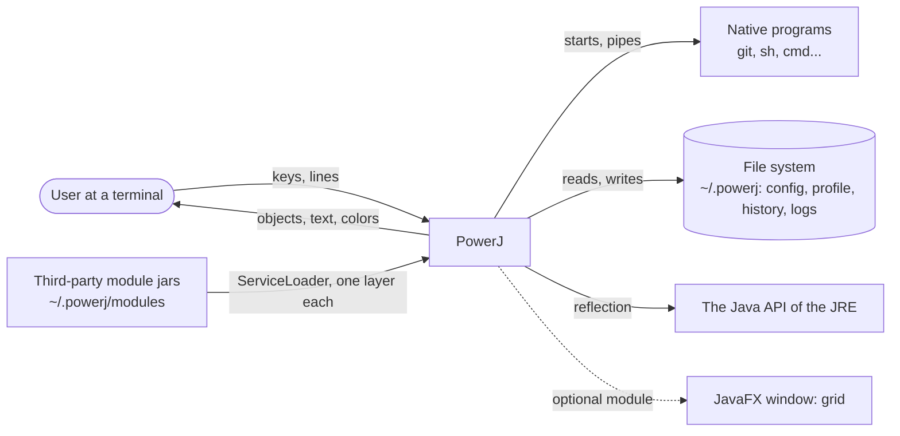
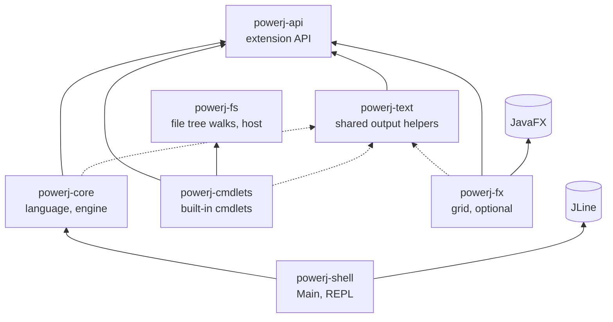

# PowerJ architecture

What PowerJ is made of, how the parts depend on each other, and which rule keeps them that way. The
[specification](SPECIFICATION.md) says *what* the shell must do; the [README](../README.md) says how to use it; the
[architecture review](REVUE-ARCHITECTURE.md) (in French) is the history of how the structure got here and what is left to do;
[docs/adr/](adr/) records the decisions and their reasons. This page describes the code as it is.

## 1. Context



PowerJ is one JVM process that runs with the rights of the user. It starts the native programs the user types, reads and
writes the user's files, loads the jars the user dropped in `~/.powerj/modules`, and exposes the JRE's classes to the
language. Nothing in it is a security boundary against that user or those jars: see [SECURITY.md](../SECURITY.md).

## 2. Modules

Every module is a JPMS module (`module-info.java`); the only runtime dependency of the product is JLine.



| Module | Depends on | Is |
|---|---|---|
| `powerj-api` | the JDK | The contract of a cmdlet (`Cmdlet`, `CmdletContext`, `@CmdletInfo`, `@Option`, `CmdletProvider`), the values it exchanges (`Row`, `Collected`, `Span`…), the capability interfaces (`Previewable`, `ColumnProvider`) and `io.powerj.api.perf`. The only module a third party compiles against. |
| `powerj-fs` | the JDK | `FileWalker` and `FileTrees`: sequential or parallel walks, copy and delete of trees; `Host`, the one place that reads the operating system. |
| `powerj-text` | `api` | What `core`, `cmdlets` and `fx` share about the output contract (reading a record, showing and parsing values), so that the terminal, the grid and the exports cannot disagree ([ADR 0010](adr/0010-shared-output-helpers-live-in-powerj-text.md)). Not API. It holds `Formats`, `RecordView`, `SizeUnits` and `GuardedText` (issues #108 to #111). In the image, so that `powerj-fx` finds it in the boot layer like `api`. |
| `powerj-core` | `api` | The language (`lang`), the engine (`runtime`, `command`, `java`, `nativeexec`, `format`), the completion (`assist`), the profiler (`perf`). Exported to the shell only. |
| `powerj-cmdlets` | `api`, `fs` | The built-in cmdlets, published through `provides CmdletProvider with BuiltinCmdlets`. **Never depends on `core`**, so a built-in cmdlet behaves exactly like a third-party one. |
| `powerj-fx` | `api`, JavaFX | `grid`. A real third-party module that happens to live in the repository; not in the distribution, and left out of the build with `-DskipFx`. |
| `powerj-shell` | `core`, JLine | `Main`, the composition root, the REPL, scripts, the profile, history. It does not require `cmdlets`: the built-in cmdlets are a provider found by the service loader, and the image build (`--add-modules` in `powerj-dist`) puts the module in the runtime. |
| `powerj-testing` | `api` | Test code shared by the tests of `cmdlets` and `fx` (#98): `TestContext`, an in-memory `CmdletContext`, and `CmdletDriver`, which runs a cmdlet as the shell does (`begin`, `process` for each object, `end`, stop sending once the cmdlet stopped its input). Test scope only: not installed, not deployed, not in the image, no coverage of its own. |
| `powerj-architecture`, `powerj-coverage` | all | Build only: the architecture rules, and the aggregated coverage report with its thresholds. |
| `powerj-bench` | `api`, `core`, `cmdlets` | JMH benchmarks, outside the default build (`-Pbench`): [docs/quality/performance.md](quality/performance.md). |
| `powerj-dist` | all but `fx` | jlink runtime and jpackage launcher. |
| `examples/greet` | `api` | An example third-party module. Not shipped. |

## 3. The core, by layer

`powerj-core` is ten packages. A package may use the ones below it, never the ones above; the rule is a test.

```text
 Plugged in   assist (completion, highlighting, help for the editor)    perf (JFR profiler, perf reports)
                  │ both plug into runtime through interfaces: CommandCatalog, ExecutionObserver, LineMeasuring
 Runtime      runtime   Interpreter (a facade), PipelineExecutor, Pipe, Supervisor, Session, Evaluator, Jobs…
 Command      command   CmdletRegistry, OptionBinder, ModuleLoader, NativeAccessPolicy, Help
 Services     format (OutputFormatter, ValueUnroller)   java (JavaInvoker, CallPolicy, PreviewPolicy…)   nativeexec
 Base         lang (Lexer, Parser, Ast: only the JDK and the API)    error    i18n
```

- **`lang`** knows nothing of the rest: a line becomes an `Ast` (a sealed hierarchy of records) and nothing more.
- **`runtime`** walks the `Ast`. `Interpreter` only orchestrates; it resolves a command through `CommandResolution` (one
  rule, a sealed `Resolved`: built-in, cmdlet, native, unknown), runs it through `PipelineExecutor`, and sends output
  through `StatementOutput` and `Redirections`.
- **`assist`** reads the world through `CommandCatalog`, never through the concrete `Interpreter`, and runs nothing:
  completion types expressions by signature and never calls a getter on a real value.
- **`perf`** is switched on by `PerfMode`; the interpreter only knows an `ExecutionObserver` (`NONE` by default), so the
  execution code has no `if (perf != null)`.

## 4. How a line runs

1. **Reading.** The shell's `Repl` reads a line with a `LineEditor` (JLine behind `InteractiveShell`); `ShellParser` and `InputCompleteness`
   decide whether the line is complete.
2. **Parsing.** `Lexer` → `Parser` (with `ExpressionParser` for Java-syntax expressions) → `Ast`. `ParseContext` carries what
   the grammar must know from outside (names of Java classes in scope, commands that take the short comparison form).
3. **Resolution.** For the first word of each command: built-in, then cmdlet, then executable on the `PATH`
   (`^name` forces native). `OptionBinder` builds the cmdlet's `Params` record from the arguments.
4. **Execution.** `PipelineExecutor` starts one virtual thread per stage, joined by bounded `Pipe`s; the last stage runs
   in the calling thread. A cmdlet gets `begin`, `process` for each object, `end`; the state of one run lives in
   `context.state(…)`, closed however the run ends. Consecutive native commands are chained with
   `ProcessBuilder.startPipeline`. A command ended by `&` is the exception: `BackgroundLauncher` starts it in a process
   group of its own through the FFM API (`posix_spawn`, `CreateProcessW`), because `ProcessBuilder` cannot (FR-75, #128).
5. **Supervision.** `Supervisor` runs the whole line, turns any `Throwable` into an `Outcome` (sealed: `Success`,
   `Failure`, `Cancelled`, `Abandoned`), and handles Ctrl+C by interrupting; a second Ctrl+C abandons a command that does not
   stop. Cancellation is the interruption of the thread plus `CancellationException`; the stages stop in cascade.
6. **Output.** `OutputFormatter` prints tables, lists and text; `ValueUnroller` is the one place that decides which
   values are unrolled into several objects.

The **session** is what a line may read or change: `Session` is a facade over `SessionState` (current, previous and
configuration folders, home, environment), `Variables`, `ShellStatistics` (last result, recent errors, perf reports),
`JavaClasses` (imports) and `Jobs`. It is written by the command thread and read by stages, jobs, completion and
preview, so its fields are `volatile` or concurrent collections.

## 5. Modes: preview and perf

`ShellMode` (`NORMAL`, `PREVIEW`, `PERF`) is held by one `ModeController` in the shell, which switches modes and tells
who shows them. **Preview** runs a line while it is typed, and only through what `PreviewPolicy` allows (an ordered
list of `PreviewRule`s: the first that has an opinion decides, no opinion means refused) and `PreviewGuard`. **Perf**
measures each line with counters, and with JFR when the runtime has it.

## 6. The shell: composition root

`Main` is one call: `System.exit(ShellBootstrap.system().execute(args))`. `ShellBootstrap` reads the arguments, resolves the
home folder, installs the log, loads `ShellConfig`, picks the language, builds one `Session`, and starts an
`InteractiveRun` or a `ScriptRun`. The process is read in three places only, `Environment` (variables, properties,
streams), `SystemTerminals` and `Main`; everything else is given what it needs, so a shell starts in a test with a folder and a few
streams. There is no dependency-injection framework (see ADR 0007).

## 7. Extension points

| Point | How | Where |
|---|---|---|
| A cmdlet or a set of cmdlets | implement `CmdletProvider`, `provides … with …` in `module-info`, or a jar in `~/.powerj/modules` | `powerj-api`, loaded by `ModuleLoader` into its own `ModuleLayer` |
| What a cmdlet can do beyond `begin/process/end` | implement a capability interface: `Previewable`, `ColumnProvider`, `AutoCloseable` state | `powerj-api` |
| What a cmdlet can ask of the shell | `context.service(PerfReports.class)`, `context.property("a.b")`, `context.setEnvironment(…)` | `CmdletContext` |
| A profiler | a `Profiler` service of `powerj-core` (JFR is the one provided) | `core.perf` |

`ApiSurfaceTest` fails when the public surface changes without its snapshot being regenerated. Nothing is published yet, so
the API may still be broken (the change is listed in the CHANGELOG); from the first release on it only grows, and a member
is deprecated with `@Deprecated(forRemoval = true)` for a release before it goes.

## 8. `powerj-fx`

`model` (table, filter, selection; it may use `javafx.base` but not the classes of the user interface), `view` (the controls), `runtime` (the thread of the toolkit) and `grid` (the cmdlet, its
options, the window opener). What touches the toolkit is behind ports (`FxPlatform`, `Scheduler`, `WindowOpener`,
`PropertyReader`), so the model is tested without a display.

## 9. The rules, and where they are checked

| Rule | Test (`powerj-architecture`) |
|---|---|
| `api` and `fs` use only the JDK | `apiDependsOnlyOnTheJdk`, `fsDependsOnlyOnTheJdk` |
| built-in cmdlets do not know the engine | `cmdletsAreIndependentOfTheEngine` |
| `fx` uses only the API; its model does not use the toolkit's UI | `fxDependsOnlyOnTheApi`, `fxModelDoesNotUseTheToolkitUi` |
| the core does not know its clients; the shell does not know `fx` | `coreDoesNotKnowItsClients`, `shellDoesNotKnowTheOptionalModule` |
| no cycle between modules, none between core packages | `modulesHaveNoCycle`, `corePackagesHaveNoCycle` |
| the layers of the core | `corePackagesRespectTheLayers`, `langDependsOnlyOnTheJdkTheApiAndText` |
| completion does not use the concrete interpreter | `assistDoesNotUseTheConcreteInterpreter` |
| the process is read in three places; the read loop does not know the editor; the shell does not use the built-in cmdlets | `shellReadsTheProcessInThreePlacesOnly`, `theReadLoopDoesNotKnowTheConcreteLineEditor`, `shellDoesNotUseTheBuiltInCmdlets` |
| no mutable static field (one exception frozen: `Language.current`); only `Main` ends the JVM | `staticFieldsAreFinal`, `onlyMainEndsTheJvm` |
| every cmdlet is declared and registered | `cmdletsAreDeclared` |

## 10. Where to look

| You want to… | Start with |
|---|---|
| change what a line means | `core.lang` (`Parser`, `ExpressionParser`), then `core.runtime.Evaluator` |
| change how a command is found | `core.runtime.CommandResolution` |
| change how a pipeline runs or stops | `PipelineExecutor`, `Pipe`, `Supervisor`, `CmdletRunner` |
| change the options of a cmdlet | its `Params` record and `@Option`; `core.command.OptionBinder` |
| call Java from a line | `core.java.JavaInvoker`, `CallPolicy`, `FunctionalAdapter` |
| change Tab completion or colors | `core.assist` (a `…Completer` per kind), `ShellCompletion` in the shell |
| change the prompt, history, profile | `PromptRenderer`, `Repl`, `ProfileRunner` in the shell |
| load a third-party module | `core.command.ModuleLoader`, `NativeAccessPolicy`, `shell.NativeAccessConsent` |
| start-up and options | `shell.ShellBootstrap` |
| make background commands work on another system | section 11; `core.nativeexec.BackgroundLauncher`, `PosixSpawn`, `WindowsSpawn` |
| read a property of an object, in a cmdlet or in the terminal | `CmdletContext.readProperty` (API), `core.java.PropertyAccess.read`; only the engine reflects on a record ([ADR 0011](adr/0011-every-command-reads-the-properties-of-an-object-through-the-engine.md)) |

## 11. Background jobs: which systems, and how to add one

A command ended by `&` (FR-75) is started by `BackgroundLauncher` **in a process group of its own**, so that the Ctrl+C of the
terminal, which goes to the foreground group, never reaches it (#128). `ProcessBuilder` cannot choose the group, so every system
is driven through its own native functions, through the FFM API.

### What is supported

| System | How the job is started | Classes |
|---|---|---|
| Windows 10 and later | `CreateProcessW` with `CREATE_NEW_PROCESS_GROUP`; only the three chosen handles are inherited (`PROC_THREAD_ATTRIBUTE_HANDLE_LIST`) | `WindowsSpawn`, `WindowsJobs` |
| Linux, glibc 2.34 or later | `posix_spawn` with `POSIX_SPAWN_SETPGROUP`; the other descriptors are closed with `posix_spawn_file_actions_addclosefrom_np` | `PosixSpawn`, `PosixJobs` |
| macOS 10.15 or later | the same functions; the other descriptors are closed with `POSIX_SPAWN_CLOEXEC_DEFAULT` and `posix_spawn_file_actions_addinherit_np`; other `O_*` values and `SIGCONT` | `PosixSpawn`, `PosixJobs` |

`BackgroundLauncher.supportedSystem()` names these three systems, `available()` adds that every function binds. A Windows batch file
(`.bat`, `.cmd`) is the one program that is not started this way (`cmd.exe` reads its command line by other rules): it goes to
`ProcessBuilder`, without protection.

### What is not, and what happens

Any other system (FreeBSD, OpenBSD, Solaris, AIX…), or a supported system whose libc lacks a function (glibc older than 2.34,
musl/Alpine, macOS older than 10.15): `available()` is false and `cmd &` is **refused** with a message that names the session variable
`POWERJ_BACKGROUND_SH_FALLBACK`. With `POWERJ_BACKGROUND_SH_FALLBACK=true` (a process variable, or `env --set` in the shell) the job is
started through `sh -c 'trap "" INT QUIT; exec …'`: it works, but it stays in the process group of the shell and only ignores `SIGINT`
and `SIGQUIT`. The message is not the same for the two causes (`background.unavailable`, `background.unsupported`).

### Why a system is not simply tried

Because nothing in the code can find out what a system is. Three things are written per system and cannot be guessed:

1. **Constants.** `O_WRONLY`, `O_CREAT`, `O_TRUNC`, `O_APPEND`, the `POSIX_SPAWN_*` flags, `SIGCONT`, `EINTR`. A wrong value does not fail: it
   opens the wrong file, or sends another signal.
2. **How the other descriptors are kept out of the child.** `ProcessBuilder` does it for us; `posix_spawn` does not. Linux has
   `addclosefrom_np`, macOS has `CLOEXEC_DEFAULT`; another system may have neither.
3. **What the terminal does to a process group**: the `SIGTTIN`/`SIGTTOU` that stop a job, the process groups that are orphaned, joining
   the group of a stage that has already ended. These are observed, not read in a manual.

FreeBSD is the likely next one: it has `posix_spawn`, the same `O_*` values as macOS, and, in its recent versions, `addclosefrom_np` and
`addchdir_np` (all to be checked on the system). It is refused all the same, because none of this has been run on it and the CI has no
FreeBSD.

### How to check that a system can be supported

1. **The functions.** All of these must exist in its libc: `posix_spawn`, `posix_spawnattr_init`/`_destroy`/`_setflags`/`_setpgroup`/
   `_setsigmask`/`_setsigdefault`, `sigemptyset`, `sigfillset`, `posix_spawn_file_actions_init`/`_destroy`/`_adddup2`/`_addopen`/
   `_addchdir_np`, and `_addclosefrom_np` or `_addinherit_np`, `pipe`, `close`, `kill`, `waitpid`, `strerror`. (`nm -D` on the libc, or the
   manual pages.) `BackgroundLauncher.available()` is true only when all of them bind.
2. **The constants.** Read them in the system headers and compare with `PosixSpawn` and `ProcessSignals`: `<fcntl.h>` (`O_WRONLY`, `O_CREAT`,
   `O_TRUNC`, `O_APPEND`), `<spawn.h>` (`POSIX_SPAWN_SETPGROUP`, `_SETSIGDEF`, `_SETSIGMASK`, and `_CLOEXEC_DEFAULT` if there is one),
   `<signal.h>` (`SIGCONT`, `SIGTERM`, `SIGKILL`), `<errno.h>` (`EINTR`).
3. **The descriptors.** Decide how the child is kept from inheriting the JVM's descriptors (a function of the libc, or the close-on-exec
   default), and check it with the test of descriptors (`PosixSpawnTest.check05`).
4. **The 14 checks of `PosixSpawnTest`** (own group, a `SIGINT` sent to the foreground group spares the job, 1000 starts without a lost
   exit status, descriptors, redirections, a pipeline, directory and environment, errors, latency). Some read `/proc` or run `lsof` or
   `ps`: give them the equivalent of the system. Then `BackgroundJobsTest`, `InterpreterTest` and `PosixJobsTest`.
5. **A real terminal**: `powerj-core/src/test/tools/pty-check.py` (a real Ctrl+C on a pseudo-terminal) and the rows G1 to G10 of
   `docs/acceptance/background.md`.

### How to add the support

1. `Host`: a method for the system (like `linux()`), and the rows of `HostTest`.
2. `PosixSpawn` and `ProcessSignals`: a branch for the constants and for the way the descriptors are kept (today a boolean per system,
   `MAC`; a third system calls for a small table of constants, not a third boolean).
3. `BackgroundLauncher.supportedSystem()`: add the system. `NativeRunner.refusal` then no longer calls it unsupported.
4. The tests: JUnit's `@EnabledOnOs` knows Linux, macOS and Windows only, so the Unix tests need an `@EnabledIf` on `Host` for the new
   system; `BackgroundJobsTest` asserts that the launcher is available on macOS, and must do the same for the new one (an assertion, not an
   `assume`: a skipped test hides a failure).
5. **The CI.** GitHub's hosted runners are Linux, macOS and Windows. A system without a job in `.github/workflows/ci.yml` (a virtual
   machine action, or a runner of its own) is supported by its owner's word only: say so in FR-75, or do not add it.
6. The documents: FR-75 (the list of the systems), this section, the changelog, and the checklist.

**Do not** make `available()` true for "any other Unix". The `sh` fallback exists for what has not been checked.
